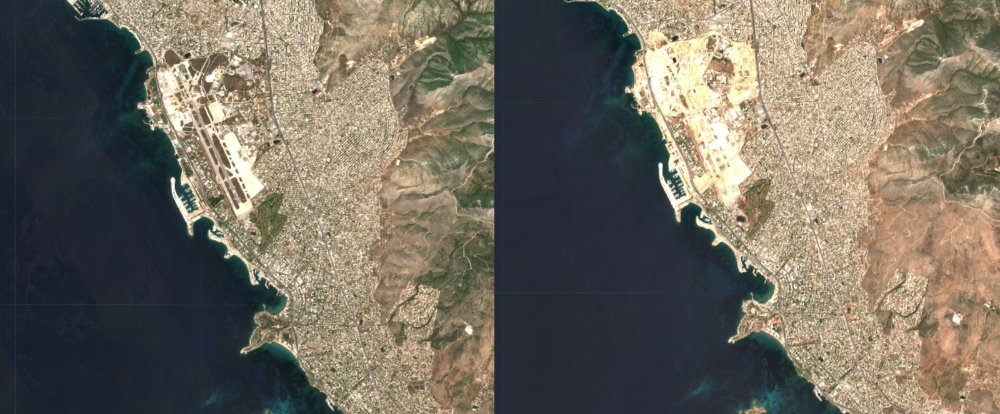
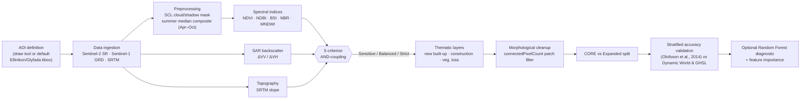

<div align="center">

# Multi-Sensor Urban Change Detection over Attica, Greece
### A Sentinel-2 · Sentinel-1 · SRTM fusion pipeline built entirely inside Google Earth Engine

*Γεωγραφική Ανάλυση Δεδομένων με τη Χρήση Google Earth Engine για την Ανίχνευση Αστικής Ανάπτυξης στην Αττική*

**BSc (Hons) Computer Science — Final Year Dissertation**
School of Architecture, Computing and Engineering · University of East London · 2025–2026

[](https://earthengine.google.com/)
[-f7df1e?style=flat-square)](gee-script/GEE_Script_v7.js)
[](#data-sources)
[](results/VALIDATION_RESULTS.md)
[](#project-status)
[](LICENSE)


<sub>Sentinel-2 natural-colour composites of the former Ellinikon Airport site, Attica — 2018 (left) vs 2024 (right). The redevelopment visible on the right is the primary case study used throughout this project.</sub>

</div>

---

## What this is

This repository holds a **multi-sensor, multi-criterion urban change detector** written entirely in the Google Earth Engine (GEE) JavaScript API. It fuses **Sentinel-2 optical imagery**, **Sentinel-1 SAR backscatter**, and **SRTM topography** to flag pixels whose spectral, radar, and terrain signatures are jointly consistent with new construction or urban development — then **quantitatively validates** those flags against two independent, open reference products: **Dynamic World** (Google/WRI, 10 m) and the **Global Human Settlement Layer built-up surface** (JRC GHSL, 100 m).

It was built and submitted as the practical component of a final-year dissertation, defended in front of a departmental board in May 2026. The tool, the validation protocol, and the write-up are all included here — the working engineering artifact lives on **this branch**, and the full academic report and defense slides live on the [`academic`](../../tree/academic) branch (see [Academic materials](#academic-materials) below).

**Quick links:** [Run it yourself](#HOW-TO-RUN) · [Results](results/VALIDATION_RESULTS.md) · [Script docs](gee-script/README.md) · [Methodology evolution](docs/METHODOLOGY_EVOLUTION.md) · [Interactive AND-logic demo](docs/and-coupling-demo.html) · [Dissertation PDF](../../blob/academic/Dissertation_Report.pdf) · [Presentation PDF](../../blob/academic/Defense_Presentation.pdf)

---

## Table of contents

1. [Why this problem](#why-this-problem)
2. [How it works](#how-it-works)
3. [The 5-criterion AND-coupling logic](#the-5-criterion-and-coupling-logic)
4. [Sensitivity profiles](#sensitivity-profiles)
5. [Validation design](#validation-design)
6. [Headline results](#headline-results)
7. [What breaks it)](#what-breaks-it)
8. [Repository structure & branches](#repository-structure--branches)
9. [HOW TO RUN](#HOW-TO-RUN)
10. [Tech stack](#tech-stack)
11. [Skills demonstrated](#skills-demonstrated)
12. [Academic materials](#academic-materials)
13. [Data sources & acknowledgements](#data-sources--acknowledgements)
14. [Citation](#citation)
15. [Project status](#project-status)

---

## Why this problem

Attica — the metropolitan basin containing Athens — has been under sustained urban pressure for decades, and its Mediterranean landscape makes it a genuinely hard place to do optical change detection: dry bare soil, exposed rock, and burned scrub can all look spectrally similar to freshly built or bare construction ground, especially in summer imagery. A change detector that relies on a single index (e.g. ΔNDBI alone) inflates false positives in exactly this kind of terrain.

The project asks a specific, falsifiable question:

> *To what extent can an interpretable, multi-sensor Google Earth Engine workflow — built on Sentinel-2, Sentinel-1, and topographic data — detect recent urban or construction-stage change in selected areas of Attica, with quantitatively assessable accuracy?*

with three sub-questions that shaped every design decision below: which indices/ancillary data reduce confusion between built-up, bare soil, and vegetation; how threshold choice trades off precision against recall; and how much the tool's output agrees (and disagrees) with independent benchmark products.

---

## How it works



Every stage above runs server-side inside GEE — there is no local processing pipeline, no exported rasters required to reproduce a run, and no dependency outside a browser and a GEE account. The full annotated script is in [`gee-script/GEE_Script_v7.js`](gee-script/GEE_Script_v7.js).

---

## The 5-criterion AND-coupling logic

A pixel is only labelled **new built-up** if it simultaneously satisfies all five of the following — a deliberate design choice over a single-index threshold, discussed in [Methodology evolution](docs/METHODOLOGY_EVOLUTION.md):

| # | Criterion | Signal | Purpose |
|---|---|---|---|
| 1 | ΔNDBI above threshold | Sentinel-2 optical | Built-up spectral signature increased |
| 2 | ΔBSI above threshold | Sentinel-2 optical | Bare/exposed-surface signature increased |
| 3 | NDVI (after year) below threshold | Sentinel-2 optical | Excludes photosynthetically active vegetation |
| 4 | ΔVV above threshold (or strong optical support) | Sentinel-1 SAR | Independent, weather/illumination-invariant structural evidence |
| 5 | Slope below threshold | SRTM DEM | Excludes rocky/mountainous terrain that mimics built-up spectrally |

You can explore this logic interactively — try the "real construction," "dry soil/rock," and "burned area" presets and watch which of the 5 gates pass or fail for each: **[`docs/and-coupling-demo.html`](docs/and-coupling-demo.html)** *(download and open locally, or view via the [academic branch copy](../../blob/academic/and-coupling-interactive-demo.html))*.

SAR is treated as **supporting evidence, not a hard gate** — an earlier iteration that required SAR unconditionally suppressed recall to unusable levels region-wide (see [Methodology evolution](docs/METHODOLOGY_EVOLUTION.md)). In the final architecture, a pixel with very strong optical evidence can still pass without a large SAR signal, but SAR alone can never trigger a detection on its own.

---

## Sensitivity profiles

Rather than exposing 12 raw threshold sliders, the tool groups them into three presets so the precision/recall trade-off is a single, interpretable choice:

| Profile | ΔNDBI | ΔBSI | max NDVI (after) | ΔVV | max slope | min patch px |
|---|---|---|---|---|---|---|
| **Sensitive** | 0.032 | 0.026 | 0.52 | 0.80 dB | 30° | 2 |
| **Balanced** *(default)* | 0.050 | 0.040 | 0.46 | 1.50 dB | 20° | 4 |
| **Strict** | 0.080 | 0.065 | 0.40 | 2.50 dB | 20° | 5 |

Full threshold table (all 12 parameters, all 3 profiles) is in [`gee-script/README.md`](gee-script/README.md#threshold-reference).

---

## Validation design

Accuracy isn't asserted, it's measured — inside the tool itself, on every run:

- **Stratified random sampling** (up to 300 points per class) following the good-practice protocol of **Olofsson et al. (2014)**, the de facto standard for land-change accuracy assessment.
- **Two independent reference products**, never used inside the detection logic itself — only in the validation step, to avoid circularity:
  - **Dynamic World V1** (Google/WRI, 10 m, near-real-time) — primary reference, resolution-matched to Sentinel-2.
  - **GHSL Built-up Surface P2023A** (JRC, 100 m, 5-year epochs) — secondary, independent-methodology reference.
- **Confusion matrix → Overall Accuracy, Kappa, Producer's/User's Accuracy (recall/precision), F1** for the positive (development) class — reported per run, not just once.
- A **CORE vs Expanded** output split, so headline accuracy is always reported against the conservative, detector-only layer (**CORE**), while the broader **Expanded** candidate layer (which folds in construction-stage pixels) is explicitly flagged as needing manual confirmation before being treated as a quantitative result.
- An **optional Random Forest classifier**, trained on Dynamic World pseudo-labels, included purely as a cross-check and a feature-importance diagnostic — with an explicit in-tool warning that comparing its predictions back to Dynamic World is *not* an independent accuracy measure, since it was trained on that same source.

---

## Headline results

Full breakdown, all 6 documented test runs, and the Random Forest / feature-importance diagnostic: **[`results/VALIDATION_RESULTS.md`](results/VALIDATION_RESULTS.md)**.

**Primary case study — Ellinikon / Glyfada / Argyroupoli, 2018 → 2024, validated against Dynamic World:**

| Sensitivity | CORE built-up | Expanded candidate | Precision | Recall | F1 |
|---|---:|---:|---:|---:|---:|
| Sensitive | 6.56 km² | 12.06 km² | 88.8% | 23.7% | 0.374 |
| **Balanced** (recommended default) | **3.32 km²** | **5.03 km²** | **88.1%** | **17.3%** | **0.290** |
| Strict | 1.95 km² | 2.71 km² | 87.9% | 9.7% | 0.174 |

The pattern is consistent and expected: **precision holds near ~88% across all three profiles** while **recall scales down monotonically** as thresholds tighten — a direct, measured consequence of AND-coupling five simultaneous criteria (one failed gate is enough to suppress a genuine detection). This trade-off is explicit and tunable, not accidental.

At GHSL's native 100 m resolution, the same AOI (~2×2 km) returned **zero positive reference pixels** — a scale-mismatch finding about the reference product at this AOI size, not a failure of the detector (documented in [`results/VALIDATION_RESULTS.md`](results/VALIDATION_RESULTS.md)).

**Two further, purpose-selected AOIs stress-test the detector beyond its best case:** a genuine secondary growth site near **Spata** (industrial/warehouse development close to Athens International Airport — precision 61.5%, a real, reported drop from the primary site), and a **specificity test on Mount Hymettus**, inside a legally protected forest (Kaisariani Aesthetic Forest, Natura 2000) chosen specifically because essentially no real development exists there. The detector returned **0.001 km²** of CORE built-up — 1 false positive out of 300 sampled negative points — exactly the near-silent result a control site is supposed to produce.

---

## What breaks it

A tool is only as credible as its documented failure modes. These are stated plainly in the dissertation and reproduced here rather than buried:

- **High precision, low recall is deliberate, not a bug.** Five simultaneous AND-coupled criteria mean one failed gate suppresses a true positive. The `Sensitive` profile trades some of that precision back for recall.
- **Impervious-to-impervious change is a structural blind spot.** When an already-impervious surface (e.g. a runway or car park) is redeveloped into buildings, ΔNDBI/ΔBSI barely move because the surface type didn't transition from bare/vegetated to built — directly relevant at the former-airport Ellinikon site.
- **Reference products are benchmarks, not ground truth.** Dynamic World occasionally labels solar/PV installations as "built"; GHSL's 100 m grid cannot resolve small AOIs (see above). Reported accuracy is *agreement with a specific benchmark*, not absolute truth — this distinction is treated as a first-class caveat throughout, not a footnote.
- **The optional Random Forest diagnostic is circular by construction** if compared back to its own training source — its only independent value is the feature-importance ranking, not its headline accuracy number.
- **Scope is intentionally bounded.** This is validated on selected Attica case-study AOIs (a redevelopment hotspot, a secondary growth corridor, and a stability-control area with minimal expected change), not a basin-wide production deployment.

---

## Repository structure & branches

This repository is deliberately split across two branches so the **engineering artifact** and the **academic paper trail** don't compete for attention:

| Branch | Contents | Audience |
|---|---|---|
| **`master`** *(this branch, default)* | The GEE script, its technical documentation, validation results, methodology notes, and the interactive AND-coupling demo | Anyone evaluating the engineering work |
| **[`academic`](../../tree/academic)** | Full dissertation report (PDF + source `.docx`) and defense presentation (PDF + source `.pptx`) | Anyone who wants the complete written thesis or the slide deck |

```
master/
├── README.md                          ← you are here
├── gee-script/
│   ├── GEE_Script_v7.js               ← the full, submitted detector (paste-and-run in the GEE Code Editor)
│   └── README.md                      ← panel-by-panel usage guide, full threshold & output-layer reference
├── results/
│   ├── VALIDATION_RESULTS.md          ← all 6 documented test runs, sensitivity sweep, RF diagnostic
│   └── screenshots/                   ← Code Editor screenshots for every run + individual layer views
├── docs/
│   ├── METHODOLOGY_EVOLUTION.md       ← how the detector got from a single ΔNDBI threshold to v7
│   ├── and-coupling-demo.html         ← interactive, self-contained HTML demo of the 5-gate logic
│   └── images/                        ← before/after composites, ΔNDVI map
├── LICENSE                            ← MIT (code only — see below)
└── CITATION.cff
```

---

## HOW TO RUN

No installation required — everything runs in Google's cloud.

1. Create a free [Google Earth Engine account](https://earthengine.google.com/signup) if you don't have one.
2. Open the [GEE Code Editor](https://code.earthengine.google.com/).
3. Paste the full contents of [`gee-script/GEE_Script_v7.js`](gee-script/GEE_Script_v7.js) into a new script and click **Run**.
4. A control panel appears on the left. Leave everything on its default (Ellinikon AOI, 2018 → 2024, Balanced, SAR + slope on, validate against **Both** references) and click **Run Detection**.
5. Results typically render in 30–90 seconds, with per-category area statistics and full accuracy metrics appended to the panel.

Full panel-by-panel walkthrough, every output layer explained, and the complete threshold table: **[`gee-script/README.md`](gee-script/README.md)**.

---

## Tech stack

- **Google Earth Engine JavaScript API** — `ee.*` server-side algebra, `ui.*` custom interactive panel (dropdowns, sliders, checkboxes, drawing tools, a dynamically-populated results panel), client/server evaluation boundaries handled explicitly throughout.
- **Remote sensing datasets** — Sentinel-2 SR Harmonized, Sentinel-1 GRD (IW, VV+VH), SRTM 30 m DEM, Dynamic World V1, GHSL P2023A.
- **Statistics** — stratified random sampling, confusion matrices, Cohen's Kappa, Overall/Producer's/User's Accuracy, F1, all computed server-side per run.
- **Machine learning** — `ee.Classifier.smileRandomForest` (250 trees) as an auxiliary, explicitly-flagged-as-non-independent diagnostic classifier with feature-importance extraction.

## Skills demonstrated

- **Geospatial / remote sensing:** multi-sensor data fusion (optical + SAR + DEM), spectral index design, cloud masking, seasonal compositing, projection/resolution harmonisation (10 m vs 20 m bands), scale-appropriate reference selection.
- **Software engineering:** a ~2,000-line, modular, defensively-coded JavaScript application with a full interactive UI, null-safe formatting, debounced event handlers, and documented architectural trade-offs.
- **Applied statistics / ML:** accuracy-assessment methodology (Olofsson et al., 2014), confusion-matrix-derived metrics, precision/recall trade-off analysis, Random Forest as a comparative diagnostic rather than a black box.
- **Scientific rigor & communication:** an explicit anti-circularity design constraint, honestly documented failure modes and blind spots, and a full academic write-up defended before a departmental board.

---

## Academic materials

The complete Greek-language dissertation report and the English/Greek defense presentation are kept on the **[`academic`](../../tree/academic)** branch, separate from the engineering artifact above, so each can be browsed on its own terms:

- 📄 **[Dissertation Report (PDF)](../../blob/academic/Dissertation_Report.pdf)** — full write-up: literature review, methodology, results, discussion, limitations, and future work (Greek, ~70 pages, [source `.docx`](../../blob/academic/Dissertation_Report.docx) also included)
- 🖥️ **[Defense Presentation (PDF)](../../blob/academic/Defense_Presentation.pdf)** — the 20-slide deck presented to the departmental board ([source `.pptx`](../../blob/academic/Defense_Presentation.pptx) also included)

See the [academic branch README](../../tree/academic) for a chapter-by-chapter index and an English-language abstract.

---

## Data sources & acknowledgements

| Dataset | Provider | Resolution | Role |
|---|---|---|---|
| Sentinel-2 SR Harmonized | ESA / Copernicus (via Google) | 10 m / 20 m | Primary optical imagery & spectral indices |
| Sentinel-1 GRD | ESA / Copernicus (via Google) | ~10 m | SAR backscatter support (VV/VH) |
| SRTM Digital Elevation Model | NASA / USGS | 30 m | Slope-based terrain filtering |
| Dynamic World V1 | Google / World Resources Institute | 10 m | Primary validation benchmark |
| GHSL Built-up Surface P2023A | European Commission Joint Research Centre | 100 m | Secondary validation benchmark |

Google Earth Engine platform: Gorelick et al. (2017), *Remote Sensing of Environment*, 202, 18–27. Accuracy-assessment protocol: Olofsson et al. (2014), *Remote Sensing of Environment*, 148, 42–57. Full bibliography in the [dissertation report](../../blob/academic/Dissertation_Report.pdf).

---

## Citation

```
Christopoulos, N. (2026). Geospatial Data Analysis Using Google Earth Engine for the
Detection of Urban Development in Attica. BSc Dissertation, School of Architecture,
Computing and Engineering, University of East London.
```

Machine-readable version in [`CITATION.cff`](CITATION.cff).

---

## Project status

Submitted 31 May 2026; defended before the College board on 27 May 2026, with positive feedback specifically on the scientific rigor of the validation design and the structure of the write-up. The script (`v7`, this repository) is the final submitted version. This repository is a portfolio re-packaging of that submission — the analytical content is unchanged from what was assessed; only the presentation and organisation have been adapted for public viewing.

---

<div align="center">
<sub>Nikolaos Christopoulos · BSc (Hons) Computer Science, University of East London · Supervisor: Dimitrios Spentzas</sub>
</div>
